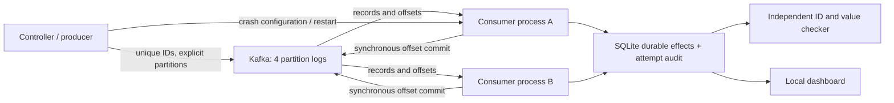

# CISC3010 — Distributed systems projects

**Selected project: Topic 14, TokenFlow.** A simple multi-turn chat application backed by two independent inference workers, load-aware routing, streaming generation, cancellation and worker-failure handling. See [TokenFlow setup and experiments](docs/LLM_README.md) and [the proposal](proposal.md). Use `scripts/start-llm.ps1 -Backend cpu-model -Port 8800` for the real model or `scripts/start-llm.ps1 -Backend simulator -Port 8790` for the separate simulator.

The 20 October update adds real Orca-style selective batching and bounded prefill on Qwen CPU inference. See [paper-to-code notes](docs/LLM_PAPER_NOTES.md) and [measured optimization results](docs/LLM_OPTIMIZATION_RESULTS.md).

The earlier Kafka prototype is preserved below.

# Replay Lab — Kafka consumer recovery

CISC3010 project 9 working demo: a real Kafka broker, four partitions, separate Python consumers, a durable SQLite application sink, deterministic crashes and an independent event-ID checker. The UI is in Chinese.

The input represents **synthetic AI inference telemetry**. No model inference is performed. Consumers calculate `usage_units = input_tokens + output_tokens`; this deliberately simple, non-idempotent application effect makes duplicate processing measurable.

## Quick start (Windows PowerShell)

Requirements: Python 3.10+, Docker Desktop with its Linux engine running, or Java 17+ for the native local-broker alternative. The pinned dependencies are Kafka **4.3.1** and confluent-kafka **2.16.0**. This repo uses no paid service, API key or GPU. Ports: Kafka `19092`, native controller `19093`, dashboard `8787`, all on localhost.

```powershell
python -m venv .venv
.\.venv\Scripts\python.exe -m pip install -r requirements.txt
docker compose up -d --wait
.\.venv\Scripts\python.exe -m kafka_demo health
.\.venv\Scripts\python.exe -m kafka_demo serve
```

Open **http://127.0.0.1:8787**. You can instead run `./scripts/start.ps1` to install dependencies, start Compose and serve the UI. See [actual validation results](docs/VALIDATION.md) and [demo screenshot](docs/demo.jpg). The checked-in `docs/sample-results/` contains four scenario runs and a complete 12-run experiment with raw evidence and figures.

### Native broker alternative

If Docker Desktop is unavailable, this repository includes a local JVM broker launcher:

```powershell
.\scripts\broker.ps1 -Action Start
.\.venv\Scripts\python.exe -m kafka_demo health
.\.venv\Scripts\python.exe -m kafka_demo serve
```

Or use `./scripts/start.ps1 -NativeBroker`. The launcher downloads the official Apache binary into `.runtime/`, verifies its SHA512 checksum, formats only this demo's own KRaft storage, and starts Java with a 512 MB heap. It does not modify system Java, Docker settings or existing Kafka data. Native Windows is a local-demo fallback; Linux/Compose is the portable deployment path. Do not run both broker modes on the same port.

## Four live scenarios

Select a scenario and click **启动实验**. Recommended presentation order:

| Scenario | Offset/effect order and injected failure | Expected observation |
|---|---|---|
| `baseline` | Durable effect, then synchronous Kafka offset commit; no crash | All IDs present; no repeated effects |
| `loss` | Commit offset, abruptly exit before writing target effect | At least one missing application effect |
| `replay` | Write effect, abruptly exit before committing target offset | Replayed ID and repeated application effect |
| `idempotent` | Same replay failure; transactionally deduplicate sink by event ID | Replayed attempt remains visible, with complete non-duplicated effects |

The target is event sequence 0, sent explicitly to partition 0. The process exits using `os._exit(86)` without leaving its group gracefully. The controller starts a replacement process with a new PID/member identity. Kafka detects the failed member and reassigns partitions. A durable fault marker prevents repeated crashes on the same replayed event. The configured classic group session timeout is 6 seconds; replacement joining and polling also affect observed recovery time.

**A verified failure experiment is not a correct business result.** `scenario_verified=true` means the intended observation occurred. `data_correct=true` means every published expected event produced exactly one valid durable effect. Loss/replay should verify the experiment while failing business correctness; idempotent recovery should pass both.

## Headless demo and independent checks

```powershell
.\.venv\Scripts\python.exe -m kafka_demo demo --scenario all --events 120 --consumers 2
.\.venv\Scripts\python.exe -m kafka_demo demo --scenario idempotent --events 240
.\.venv\Scripts\python.exe -m kafka_demo check runs\YOUR_RUN_DIRECTORY
.\.venv\Scripts\python.exe -m unittest discover -s tests -v
```

Global broker option goes before the command, e.g. `python -m kafka_demo --bootstrap localhost:19092 health`.

Each run gets a unique topic/group and directory, avoiding cross-run offsets. The deterministic input seed is 3010. Topics retain data for 24 hours; they are not automatically deleted. Their names begin with `cisc3010-`. Only processes spawned by a run are stopped by that run.

## Required consumer-count experiment

```powershell
.\.venv\Scripts\python.exe -m kafka_demo experiment --counts 1,2,4,6 --repeats 3 --events 240 --processing-ms 15
```

This holds partitions at four, replays the same event values and partition mapping with new IDs, and alternates consumer-count order between repetitions. The workload is a finite producer burst; elapsed time runs from production through observation of the final synchronous commit, excluding broker/topic/group startup. Processing includes a fixed per-event sleep, SQLite transactions and Kafka commits. Results are **application-pipeline measurements, not Kafka maximum-capacity benchmarks**. Consumers above the partition count can receive empty assignments.

`runs/experiment-*/results.csv` records each repetition; `config.json` records controls and assumptions, and every nested run preserves raw evidence. Report variation rather than selecting a single best run. Use the plotting script below after installing its pinned optional requirement:

```powershell
.\.venv\Scripts\python.exe -m pip install -r requirements-plots.txt
.\.venv\Scripts\python.exe scripts\plot_results.py runs\experiment-YOUR_DIRECTORY
```

The plot script checks every measured run's correctness and displays mean throughput with sample standard deviation and individual observations.

An eight-event warmup run precedes the measured runs and is excluded from the CSV; `warmup.json` identifies its raw artifacts. Local Python clients explicitly use IPv4 to match the loopback listener. Optional plot dependencies require Python 3.11+.

## Evidence and architecture



Every `runs/<id>/` contains:

- `manifest.json`: config, versions/environment, topic/group, broker metadata, workload assumptions.
- `input.jsonl`: exact sample input.
- `audit.sqlite3`: expected delivery acknowledgements, all attempts, effects, dedup markers, faults, workers and timeline.
- `expected.csv`, `attempts.csv`, `effects.csv`, `workers.csv`, `faults.csv`, `timeline.jsonl`: raw exports.
- `result.json`: checker, duration, throughput, fault count and recovery measurement; or `error.json` for a failed run.
- `consumer-*.log`: per-process diagnostics.

An attempt is logged before application processing, `applied_at` after the sink transaction, and `committed_at` only after a successful synchronous Kafka commit. Committing a message acknowledges the **next offset** (processed offset + 1). SQLite dedup markers and business effects are in one transaction. The checker separately detects missing IDs, unexpected IDs, repeated effects, replayed attempts, corrupted usage values and unacknowledged input delivery.

## Assumptions and limits

- One KRaft broker with replication factor one suffices for this consumer experiment; broker availability and multi-broker replication are not demonstrated.
- All processes share one host and one SQLite sink. WAL and a busy timeout permit concurrent readers/writers, but durable writes serialize. This limits local throughput.
- UI polling adds observational load. Use the same observation configuration across compared runs. The completion monitor polls at 100 ms intervals; timing includes this observation granularity.
- `recovery_to_processing_s` measures the interval from recorded crash to the first later receive on that partition, not just the internal rebalance duration.
- No blanket exactly-once delivery claim: Kafka may replay messages; this demo's idempotent SQLite transaction prevents duplicate effects for retained event IDs. External APIs need their own idempotency mechanism. Sink loss, ID reuse, arbitrary simultaneous process failures and producer uncertainty are outside the demonstrated guarantee.
- Performance variation and slowdowns are valid results. Measure before making speedup claims.

## Stop

Stop the dashboard with Ctrl+C; active consumer processes are cleaned up. Stop a native broker with `./scripts/broker.ps1 -Action Stop`, which checks that its saved PID still belongs to this demo's Java command. Stop Compose with `docker compose down`; the named data volume is retained.

## Reading and attribution

- [Kafka: a Distributed Messaging System for Log Processing](https://www.microsoft.com/en-us/research/wp-content/uploads/2017/09/Kafka.pdf): partitioned append-only logs, consumer progress and replay. Here the application effects live in SQLite and one local broker simplifies deployment; this does not reproduce Kafka's original cluster experiments.
- [Apache Kafka quickstart](https://kafka.apache.org/quickstart/), [consumer configuration](https://kafka.apache.org/43/configuration/consumer-configs/), and [confluent-kafka Python client](https://docs.confluent.io/platform/current/clients/confluent-kafka-python/html/index.html).
- [AI-use statement](AI_USE.md). This project is still an initial working demo; a final 3–4 page report, presentation-feedback changes and any optional replication extension remain future work.
