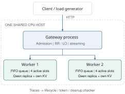
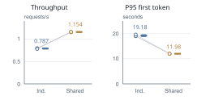
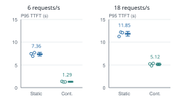

# TokenFlow: Request Routing and Iteration-Level Execution for Local LLM Serving

**CHEONG KIN NGAI (Bankey) | CISC3010 | Topic 14 | Final project report**

<!-- REGION p1-left -->
## Abstract

Serving requests with different lengths requires decisions both between model replicas and within each replica. TokenFlow implements an HTTP gateway, two independent Qwen2.5-0.5B-Instruct workers, streamed responses, and trace-based checks on one CPU host. A controlled real-model study replays 2,880 requests across 24 trials. Least-outstanding routing lowers mean trial P95 time to first token at 1 request/s, but neither tested rate establishes a reliable throughput winner. A separate execution comparison increases throughput from 0.787 to 1.154 requests/s by sharing suitable transformer operations. A simulator isolates static versus continuous admission, while fault and cancellation tests check request cleanup. The results distinguish worker selection, admission timing, and execution, with explicit limits on shared-host and workload generalization.

## 1  Introduction

An LLM service must choose where a request runs and how its tokens share computation with other requests. These choices interact with variable prompt lengths, variable output lengths, and the growing key-value (KV) state used by Attention. A low request count need not mean a low remaining token workload.

This project asks two questions: **Does least-outstanding routing improve response time over round robin under a fixed mixed workload? Which benefits come from worker scheduling and shared computation instead?** TokenFlow exposes queues, active slots, execution pieces, and terminal outcomes so each claim can be tied to a measured mechanism.

The implemented work comprises a request gateway and independent worker lifecycle; an iteration scheduler and selective Qwen execution path; and a trace checker with reproducible comparisons. It uses pretrained weights and existing tensor operations rather than training a model or recreating a production provider's infrastructure.

## 2  Background and scope

Orca [1] motivates admitting requests at iteration boundaries and batching selected operations. Sarathi-Serve [5] motivates bounding prompt work alongside decode. TokenFlow adapts these ideas to full CPU replicas. DistServe [6] motivates distinguishing first-token delay from streaming delay; phase disaggregation itself is outside this implementation.

<!-- REGION p1-right -->

## 3  System design

### 3.1  Whole-request routing and admission

The gateway checks per-client request, concurrency, and estimated-token limits. Excess traffic receives HTTP 429 and a retry hint. Accepted requests are assigned to a healthy worker, and token events stream through the gateway to the client. Client labels are a local demo mechanism; production authentication and billing are outside scope.

Round robin (RR) rotates among healthy workers. Least outstanding (LO) minimizes the count of assigned, unfinished requests, including queued and running work. Selection and accounting are atomic under one gateway lock. Counts are released on completion, cancellation, or failure. Both long and short requests contribute one to the routing score.

### 3.2  Worker scheduling and state

Each worker is a separate process with a complete Qwen model [2], a FIFO queue, four active slots, and request-local KV state. Continuous admission fills freed slots at step boundaries. Slot and token-reservation budgets bound active work; admission timing differs from choosing a worker.

During selective execution, compatible token pieces share projections, normalization, and MLP operations; Attention and KV updates remain request-local (Figure 3). The backend uses PyTorch and Transformers [3, 4]. No request can attend to another request's history.

<!-- REGION p2-top -->
## 4  Controlled routing evaluation

<!-- REGION p2-left -->
### 4.1  Experimental setup

The primary experiment uses Windows, Python 3.13.9, an Intel Core Ultra 5 338H with 12 logical CPUs, and approximately 31.5 GiB RAM. Both workers use FP32 Qwen2.5-0.5B-Instruct, two model threads each, four active slots, and a 4,096-token reservation budget. Continuous admission, selective execution, and a shared 128-token prefill allowance are held fixed.

Each trial sends the same saved mix of 120 short/long requests at fixed intervals, at 1 or 3 requests/s. Output caps are 16 or 48 tokens. Arrivals are **open loop**: sending a new request does not wait for earlier completions. Workers warm up before measurement; controlled benchmark quotas avoid admission rejections. At each rate, six paired repeats alternate policy order. The comparison contains 24 trials and 2,880 requests.

### 4.2  Metrics and uncertainty

Throughput divides successful requests by the interval from first scheduled dispatch to final client outcome. Client-observed time to first token (TTFT) and completion time use one monotonic client clock. Per-trial P95 values are summarized across trials, rather than pooling requests across runs.

Variation in Figure 2 is sample SD. The reported 95% intervals instead use Student-t intervals over six **paired trial differences**. Requests and tokens are not treated as independent repetitions. With six pairs, these intervals are approximate and generalization remains limited.

<!-- REGION p2-right -->
### 4.3  Results and interpretation

At **1 request/s**, throughput is 0.964 ± 0.017 for RR and 0.971 ± 0.005 requests/s for LO. Mean trial P95 TTFT falls from 3.72 ± 1.29 to 2.37 ± 0.29 s. The paired mean reduction is 1.35 s, with an approximate 95% interval of [0.23, 2.48] s. Mean trial P95 completion falls from 13.13 to 11.53 s.

At **3 requests/s**, throughput is 1.294 ± 0.061 for RR and 1.269 ± 0.057 requests/s for LO. P95 TTFT is 45.44 ± 4.40 versus 45.69 ± 2.75 s; P95 completion is 52.63 versus 53.34 s. The paired throughput intervals include zero at both rates: the study establishes neither a reliable throughput winner nor equivalence.

At the higher load, full-slot fractions are 92.6% (RR) and 90.3% (LO). Gateway CPU is about 10.5% and 10.7% **of one logical core**. This indicates worker-side queueing pressure without observed gateway CPU overload; it does not establish whole-host CPU or memory-bandwidth saturation.

Outstanding request count does not measure remaining tokens, and RR already distributes this mix reasonably evenly. These are plausible explanations for the small throughput difference, not experimentally isolated causes. A separate constructed alternating-order diagnostic has 16 trials and 1,024 requests; it is retained in the evidence and excluded from this primary comparison.

<!-- REGION p3-top -->
## 5  Separating scheduling from model execution

<!-- REGION p3-left -->
### 5.1  Shared execution on real Qwen

Both modes use LO, continuous admission, two workers, arrivals at 6/s, and identical prompts, output caps, and bounded prefill. Both compute vocabulary logits only at output-producing positions. Only execution changes.

Throughput rises from 0.787 ± 0.008 to 1.154 ± 0.006 requests/s (**46.7%**). Mean trial P95 TTFT falls from 19.18 to 11.98 s, and P95 completion from 26.54 to 17.15 s. All workload-position token IDs match across the six trials. This is an execution result on a congested CPU workload, separate from the routing comparison.

### 5.2  Bounded prefill has a tradeoff

Holding selective execution fixed, a separate comparison changes whole-prompt prefill to a 128-token shared allowance, with three trials per setting and 24 requests per trial. Intermediate chunks update KV without producing output.

| **Gap metric (ms)** | **Whole prompt** | **128 tokens** |
| --- | --- | --- |
| P95 | 544.6 ± 6.9 | 854.6 ± 34.2 |
| P99 | 1,962.9 ± 27.8 | 913.7 ± 21.0 |

**Table 1. Real-model streaming tradeoff.** Mean ± sample SD of per-trial gap percentiles; lower is better.

<!-- REGION p3-right -->
### 5.3  Continuous admission in the simulator

The simulator holds LO routing, two workers, four slots, a 32-token prefill allowance, and the same request mix and timing model fixed. Static admission waits for an active cohort to finish before admitting another; continuous admission fills freed slots at step boundaries. Each trial has 36 short and 12 long requests. The 28 October rerun contains 12 trials and 576 requests.

Decode step cost is (0.012 + 0.002 × active decode requests) s; prompt-chunk cost is (0.003 + 0.00025 × chunk tokens) s. The simulator therefore isolates a stated service model rather than predicting real-model speedup.

At 6/s, mean trial P95 TTFT drops from 7.36 to 1.29 s; at 18/s, from 11.85 to 5.12 s. Short-request mean queue wait drops from 2.96 to 0.38 s and from 5.01 to 1.99 s, respectively. The earlier 12-trial suite shows the same direction and remains separately archived.

### 5.4  Reading the streaming tradeoff

Table 1 shows that chunking reduces rare long gaps while worsening P95. Prefill interference is spread across more iterations rather than eliminated. P99 was inspected after the initial P95 result; with only three trials, this is descriptive evidence requiring a larger prospective test. Correlated token gaps are not independent statistical samples.

<!-- REGION p4-left -->
## 6  Correctness and failure behavior

### 6.1  Trace and numerical checks

The independent checker verifies one assignment and one terminal outcome per admitted request, ordered non-duplicated token events, model-step piece accounting, and cleanup of outstanding counts, slots, and reservations. Expected fault runs can pass lifecycle checks while containing explicit failed outcomes.

Twelve actual-model reference cases match Transformers-generated token IDs, covering heterogeneous prompts, conversation context, chunk sizes, and a late arrival. An FP32 teacher-forced audit compares full-vocabulary logits and per-layer KV values. The maximum recorded absolute logit difference is 2.05 × 10^-5, within the recorded tolerances, with no argmax differences.

An earlier BF16 audit failed strict numerical agreement when changed matrix shapes rounded close logits into a tie. The failed audit is retained; the final backend and reported real-model comparisons use FP32. This correction avoids mixing development speed measurements with validated final results.

The full routing archive checks 40 trials, 3,904 requests, and 108,800 output tokens, including the separately labelled order diagnostic. On 28 October, all 32 automated tests passed, including the earlier Kafka tests. These checks validate observed cases rather than every input and failure mode.

### 6.2  Partial failure and cancellation

Stopping one real-model worker during a 16-request run yields nine completions and seven explicit failures. Detection takes 0.554 s in that run. New requests use the surviving worker. Restart is manual and includes model loading; an interrupted partial answer is not resumed or silently replayed.

In a separate 12-request run, nine requests complete and three are cancelled. The checker finds no remaining reservations. The recorded product demo also shows chat, both routing policies, HTTP 429 admission control, execution inspection, cancellation, and failure/recovery.

## 7  Limitations and implications

The study uses synthetic templates, fixed output caps, two arrival rates, and two replicas sharing one host. It is neither a representative production trace nor an answer-quality evaluation. CPU and memory interference, few repetitions, and coarse P95 estimates constrain generalization. A larger heterogeneous or multi-host workload could change the routing result.

The gateway and host are single failure points. The system does not implement model sharding, GPU kernels, PagedAttention, cross-request prefix KV reuse, phase disaggregation, or seamless output replay. Live KV tensor bytes exclude allocator overhead and process/model memory.

<!-- REGION p4-right -->
## 8  Reproducibility and project contributions

The submission contains source, pinned dependencies and model revision, startup and experiment commands, sample requests, the architecture, demo video and captions, raw traces, checker, and plotting scripts. The report builder recreates vector figures directly from the submitted CSV/ZIP evidence; no local run directory or model download is needed to rebuild this PDF.

Clean-checkout checks start both the simulator and real model with two healthy workers and complete sample requests. Fresh dependency installation was checked using cached pinned model weights; the full first-time weight download was not repeated. The setup documents Windows as the verified environment.

No specific presentation feedback was received. Subsequent work audited deliverables against the assignment, packaged raw evidence and portable verification, reran the simulator comparison and automated checks, and improved the report's architecture and experimental presentation.

The project adds gateway accounting, worker lifecycle, scheduling, selective execution, observability, checks, and experiments around pretrained Qwen and PyTorch/Transformers. Codex provided substantial design, implementation, test, experiment, and documentation assistance; its use and validation are disclosed in `AI_USE.md`. Existing libraries and readings are attributed below.

## 9  Conclusion

TokenFlow demonstrates three distinct serving decisions with an inspectable application. LO improves first-token delay at the tested lower arrival rate, but the primary routing study does not identify a reliable throughput winner. A separate real-model experiment supports shared execution in the tested configuration, while simulation supports continuous admission under its stated timing model. Tail-gap and fault observations show why throughput alone is insufficient to judge a serving design.

## References

[1] G.-I. Yu et al. **Orca: A Distributed Serving System for Transformer-Based Generative Models.** OSDI, 2022. [Paper and proceedings](https://www.usenix.org/conference/osdi22/presentation/yu).

[2] Qwen Team. **Qwen2.5-0.5B-Instruct.** Pretrained model and model card. [Hugging Face](https://huggingface.co/Qwen/Qwen2.5-0.5B-Instruct).

[3] PyTorch contributors. **PyTorch documentation.** Tensor operations and CPU inference. [Documentation](https://pytorch.org/docs/).

[4] Hugging Face. **Transformers documentation.** Model loading, generation, and cache interfaces. [Documentation](https://huggingface.co/docs/transformers/).

[5] A. Agrawal et al. **Taming Throughput-Latency Tradeoff in LLM Inference with Sarathi-Serve.** OSDI, 2024. [Paper and proceedings](https://www.usenix.org/conference/osdi24/presentation/agrawal).

[6] Y. Zhong et al. **DistServe: Disaggregating Prefill and Decoding for Goodput-optimized Large Language Model Serving.** OSDI, 2024. [Paper and proceedings](https://www.usenix.org/conference/osdi24/presentation/zhong-yinmin).
